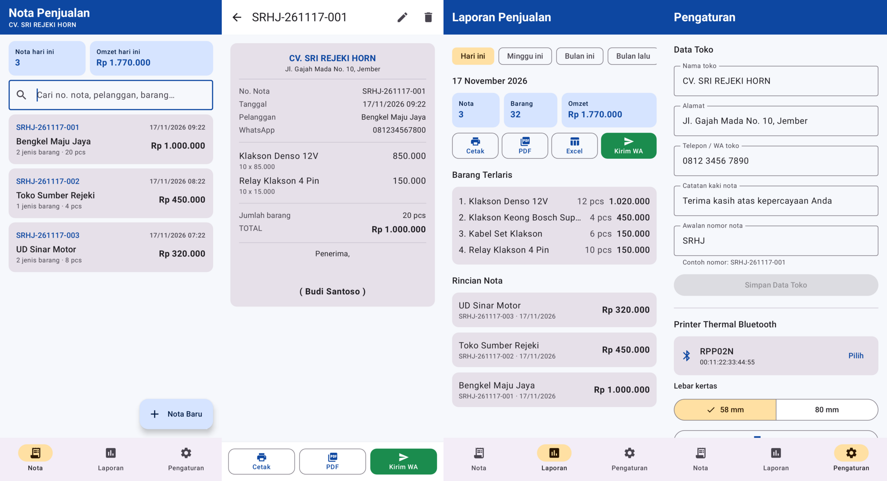

# Nota-Cv.Srhj
Aplikasi Android pembuatan nota **CV. Sri Rejeki Horn Jember**.



## Fitur
| Fitur | Keterangan |
|---|---|
| **Nota** | Nama toko, nomor nota otomatis (`SRHJ-yyMMdd-001`, reset tiap hari), tanggal, pelanggan, no. WA pelanggan, daftar barang (nama, jumlah, harga), total otomatis, nama penerima, **tanda tangan penerima** (coret di layar), catatan |
| **Cetak** | Printer thermal Bluetooth (ESC/POS), kertas **58 mm** atau **80 mm**, tanda tangan ikut tercetak |
| **Simpan file** | Nota → **PDF ukuran A5**; Laporan → **PDF A4** dan **Excel (CSV)**. Tersimpan di `Download/NotaSRHJ` |
| **Kirim WhatsApp** | Membuka **WhatsApp Business** (cadangan: WhatsApp biasa) dengan file PDF terlampir. Jika no. WA pelanggan diisi, langsung ke chat pelanggan tersebut |
| **Laporan** | Hari ini / minggu ini / bulan ini / bulan lalu / pilih tanggal: jumlah nota, barang terjual, omzet, barang terlaris, rincian nota. Bisa dicetak, PDF, Excel, kirim WA |
| **Pengaturan** | Data toko (nama, alamat, telepon, catatan kaki, awalan nomor), pilih printer, lebar kertas, tes cetak |

Contoh hasil: [Nota PDF](docs/contoh/contoh-nota-pdf.png) · [Laporan PDF](docs/contoh/contoh-laporan-pdf.png)

## Cara pakai printer
1. Nyalakan printer thermal, lalu **pairing** di menu Bluetooth HP (PIN biasanya `0000` atau `1234`).
2. Buka aplikasi → **Pengaturan** → **Pilih** printer → pilih lebar kertas → **Tes Cetak**.

## Struktur proyek
```
app/src/main/java/com/srhj/nota/
├── MainActivity.kt        navigasi (Nota · Laporan · Pengaturan)
├── NotaApp.kt             database, pengaturan, printer
├── data/                  Room: Nota, ItemNota, NotaDao; Pengaturan (SharedPreferences)
├── print/                 EscPos (perintah printer), StrukTeks (tata letak struk), PrinterBluetooth
├── pdf/                   PdfGenerator (nota A5 & laporan A4)
├── share/                 Berkas: simpan ke Download, kirim WhatsApp Business
├── util/                  format Rupiah/tanggal, nomor nota, laporan & CSV, tanda tangan
└── ui/                    layar: daftar, form, detail, laporan, pengaturan, komponen
```

## Build
Butuh JDK 17+ dan Android SDK 35 (atau buka folder ini di Android Studio).
```bash
./gradlew assembleDebug        # APK: app/build/outputs/apk/debug/app-debug.apk
./gradlew testDebugUnitTest    # 18 uji: logika, database, PDF, struk, alur aplikasi
```
Minimal Android 8.0 (API 26).
